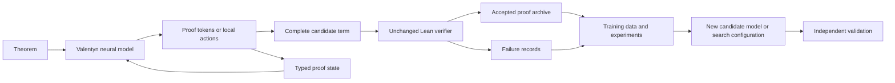

# Valentyn-1: a model-centered, verifiable research architecture

The project and models are named **Valentyn**, superseding the Prometheus names in the supplied brief. The existing `valentyn` package remains the shared local/scalable interface. Empty subsystem directories were not added.

## What the model actually does

There are three from-scratch neural implementations:

1. A small causal Transformer reads a theorem and predicts an entire Lean proof term token by token.
2. A recurrent sequence model performs the same task, giving an alternative to attention.
3. A factorized recurrent policy reads a typed local goal and hypotheses, then chooses a proof-construction action. Actions introduce assumptions, construct pairs/disjunctions, apply a hypothesis, split cases, or use an available fact. An interpreter assembles those model-chosen steps into a complete proof tree.

The third model has a symbolic **environment**, not a symbolic-solver fallback. It receives legal-action masks, conjunction projections, and current types. Those supply substantial structure, so untrained and random policies are evaluated in exactly the same environment. The existing `Prover.solve` is used to generate supervision and as a baseline; it is not called by neural evaluation. Tests enforce that separation.

## Learning objectives

The whole-term models minimize masked next-token loss:

`L_term(θ) = -Σ_(theorem,proof) Σ_t log π_θ(proof_t | theorem, proof_<t)`.

Theorem tokens are conditioning input, not supervised output. Padding and prompt targets are ignored. No pretrained weights, external teacher model, or commercial API is used.

Verified teacher terms are decomposed into local inference decisions. The factorized policy minimizes:

`L_state(θ) = -Σ_(state,action) log π_θ(action | goal, typed_context)`.

During generation, only legal actions receive probability mass. A bounded best-first search ranks partially built trees using cumulative policy log probability. The frontier is capped at 64 entries; node, context, and time limits are explicit. A policy can choose poorly, cycle, or exhaust its budget. A complete term is accepted only after Lean compilation and a zero-axiom dependency audit.

This is supervised learning from formal evidence, not yet reinforcement learning or a learned world model. A value function, verified self-generated replay, and abstraction learning are research extensions with separate ablations.

## Evidence boundaries

The 1,000 training, 80 validation, and 100 initial test theorems are generated by substituting expressions into known propositional proof patterns. Canonical atom-renaming removes duplicate structures across splits. Two theorem families are excluded from fitting. This tests a narrow form of transfer, not natural-language mathematics or research discovery.

The initial test exposed a composition failure and was therefore used for architecture development. A second 128-problem suite was generated **after freezing checkpoint hashes**, excluding every original structural example. Its generator mixes longer implication chains, nested cases, nested pair rearrangement, and case analysis followed by pair rearrangement. All reference proofs are Lean-checked. Models do not receive reference proofs at evaluation.

The fresh suite is stronger evidence against exact-example memorization. Its families are still synthetic and correlated. New independent task generators, multiple model-training seeds, matched representation ablations, and mathematical domains beyond propositions remain necessary.

## Independent improvement gate

`model-evolve` evaluates beam-width changes with fixed model weights and an unchanged verifier on validation only. Promotion requires no lost solves, a multiple-comparison-adjusted paired sign probability at most .05, and no higher measured inference time per solved task. The probability is exploratory because synthetic theorem samples are not fully independent. Timing is noisy; a serious promotion decision needs repeated cost measurements.

The selected configuration is saved separately. Failed configurations and their proof attempts remain in the archive. Neither executable source, model weights, nor verification standards are modified by this loop. A wider beam producing more proofs at higher cost is reported as a tradeoff, not free recursive improvement.

## Local and scalable tracks

The dependency-free symbolic system remains available. The optional model extra uses PyTorch, CPU, and Apple Metal. Model files contain small state dictionaries, a bounded architecture manifest, and a checksum; loading uses `weights_only=True`. No arbitrary checkpoint code is executed by the model loader.

The observed machine has 16 GB unified memory. Training is designed conservatively for an 8 GB target, with small batches, 256-token whole-term contexts, 512-token local-state contexts, compact vocabulary, sequential Lean checks, and disk-backed records. A physical 8 GB machine was not tested. Process RSS and MPS allocator/driver counters overlap and must not simply be added as a precise unified-memory measurement.

For these tiny models, four-bit weights and sparse experts add complexity with little likely memory benefit. MLX-LM remains an optional later instrument for larger pretrained models. MPS was selected here because an installed PyTorch runtime supported both recurrent and attention baselines without another download. Actual speed/memory results are reported, not inferred from parameter count.

Both tracks share theorem parsing, candidate terms, verification, SQLite records, dataset digests, and evaluation reports. A future remote proposal model must use the same acceptance boundary. Mathlib, SymPy, Z3, quantified terms, and exact construction search should be added through typed adapters when a specific experiment needs them; none is silently claimed as implemented.

## Novelty and scientific judgement

Current outputs are known elementary propositional theorems and local proof artifacts. No mathematical novelty is claimed. Future novelty records should preserve original statements, source citations, library searches, conjecture dates, candidate classification, formalization review, and independent expert review. Validity, faithful specification, novelty, and importance are separate assessments.
